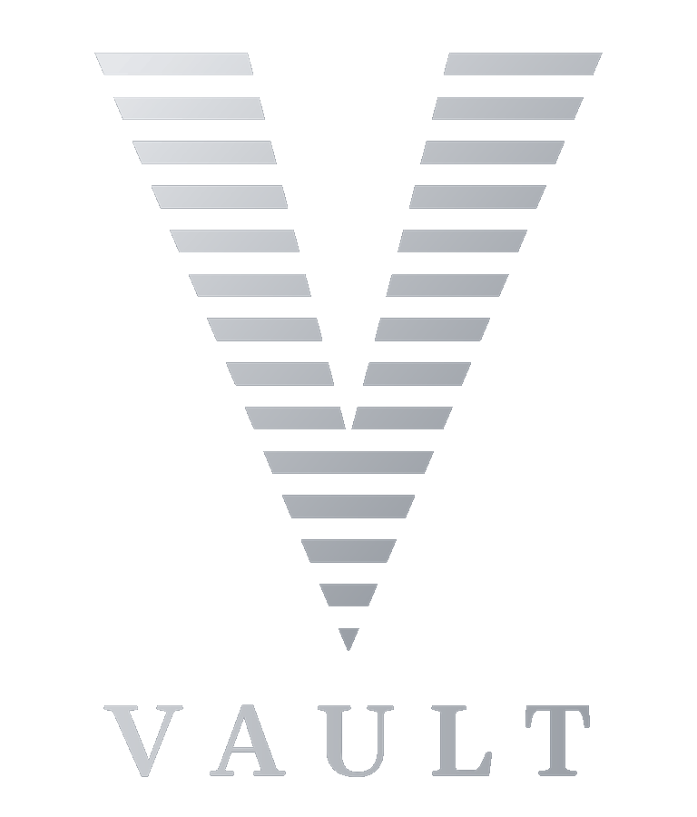

<p align="center"></p>


# Valid Vault Password Manager

[](https://github.com/validprivacy/valid-vault/actions/workflows/test.yml)

A local, encrypted, QR code portable password manager that works without a cloud service, an account, or a sync server. Your credentials live on your device, encrypted under keys only you can produce, and move between devices over a fully local QR stream or an encrypted backup file.

**Status: Late beta.** Every feature works end to end, and the remaining work is final bug fixes and polish before 1.0. See [ROADMAP.md](ROADMAP.md) for what's left, and [OVERVIEW.md](OVERVIEW.md) for a short summary of the product and its design.

**Website:** the [Valid Vault page](https://validprivacy.github.io/vault.html), the [User Guide](https://validprivacy.github.io/vault-guide.html), and the [Privacy Policy](https://validprivacy.github.io/vault-privacy.html) are on the Valid Privacy site.

**Chrome Web Store:** install the extension from [Valid Vault on the Chrome Web Store](https://chromewebstore.google.com/detail/valid-vault-password-mana/fkpfaemmphmakebhejhaegjgcnieeoab).

**Microsoft Edge:** fully compatible, installed from the Chrome Web Store. Valid Vault is deliberately not on Microsoft's Edge Add-ons store. See [Using Valid Vault on Microsoft Edge](#using-valid-vault-on-microsoft-edge) for the two-minute install and the reason why.

**Community:** updates, support, and bug reports on the [Valid Vault Discord](https://discord.gg/2SP383cJs9).

---

> ✅ **Lock and Clear Hardening - v0.9.4.3**
>
> Fixes from an AI-assisted review of the source code. No independent security audit has been done yet. Locking now closes any fill list already open on a page, and a login, Personal Info value, or 2FA code that finishes decrypting after the lock is thrown away instead of filled. Clear Vault removes the browser's backup copy first and reports an error instead of success if anything could not be removed, so a cleared vault can never come back on its own. On a page without https, the extension asks before filling, the same way the phone's private browser does. On the phone, screenshots and the recent apps preview of the vault and the private browser are now blocked by default, with a setting to allow them, and the vault locks after you leave the app, 30 seconds later by default. THREAT_MODEL.md lays out what Valid Vault defends against and what it leaves to the device, the docs describe matching and Android Autofill exactly as the code does it, and 174 automated tests cover the new behavior. See [CHANGELOG.md](CHANGELOG.md) for full details.

> ✅ **Tested in the Open - v0.9.4.4**
>
> Every push now runs the full test suite on GitHub Actions, with the result shown by the Tests badge at the top, along with a check that the phone bundle matches the source byte for byte and a dependency audit. Fuzz tests feed thousands of damaged vault files, key files, and QR frames to the parsers and confirm each one is refused cleanly without touching the vault. SECURITY.md sets out how to report a vulnerability. Capacitor is updated to 7.6.10 for a WebView navigation fix. A new [You Are the Custodian](#you-are-the-custodian) section explains self-custody, and the docs say plainly that login phishing protection needs no block list. See [CHANGELOG.md](CHANGELOG.md) for full details.

> ✅ **Signup Forms Fixed - v0.9.4.5**
>
> Opening a dropdown on a signup form, like a birthday picker, no longer brings up the save prompt as if the form had been sent, so signups such as Discord's can be finished. The save prompt now asks only when a form is really submitted, and it closes when you click outside it or press Escape, the same as Not now. See [CHANGELOG.md](CHANGELOG.md) for full details.

> ✅ **Safer Sync and Restore - v0.9.4.6**
>
> A sync that stops partway, such as when storage fails between sections, now says so, and Manage, the popup, and the phone app show that it did not finish until you sync the same vault again. The extension's backup copy repairs itself after a failed save, and if the browser ever loses its vault data, Valid Vault tells you it restored from the backup copy, when that copy was made, and whether anything newer is missing. See [CHANGELOG.md](CHANGELOG.md) for full details.

---

## What is Valid Vault?

Valid Vault is a self-hosted password manager built on a master key wrap architecture. One random 256-bit master key encrypts your vault. That key is never stored raw, it's wrapped independently under each unlock method you set up, and unwrapping it is the act of authentication itself.

**How unlock works:**

* Password - wrapping key derived via PBKDF2-SHA256 at 600,000 iterations with a per-wrap salt, minimum 12 characters with a letter, a number, and a symbol, and common passwords refused; why PBKDF2 and not Argon2id is covered in [Design Decisions](ROADMAP.md#design-decisions)
* Device unlock (Android) - the master key is wrapped by an Android Keystore key, held in secure hardware on phones that have it, that requires device authentication (fingerprint or system PIN) to use
* Device unlock (extension) - the platform authenticator via WebAuthn, covering fingerprint and the device's own PIN
* A wrong credential makes the unwrap fail; no password hash is stored, so the only way to test a guess is to run the full key derivation

Your data stays on your own devices, so there is nothing on a company's server to be subpoenaed, breached, or sold.

**One vault, many surfaces.** The same master key that unlocks your vault on one browser unlocks the same vault file on another browser, or on the phone. Import a key once and it becomes that browser's key going forward. On one computer, Uni-Vault links every browser to a single encrypted vault file and keeps them in sync automatically. Between devices, moving the vault is a manual Export and Import or QR share, merged by the same timestamp-based logic without any server.

---

## You Are the Custodian

Valid Vault is built so that you hold your vault the way you hold cash or a hardware wallet: directly, with no company in the middle. Nobody else has a copy, nobody can lock you out, and nobody can lose it for you.

**What you hold.** Two files and what is in your head:

* The vault file, your encrypted logins, Personal Info, wallets, and bookmarks. It is ciphertext and opens nothing without the master key
* The key file, your master key wrapped under your passphrase, plus three additional answers
* The passphrase and the three answers that open the key file

Every device you set up also holds a working copy of the vault and its own way to unlock it. Any unlocked device can write a fresh vault file and a fresh key file at any time.

**What custody gives you:**

* **No breach target.** There is no server holding everyone's vaults, so there is nothing for an attacker to steal in bulk
* **No account to lose.** No sign-in, no locked account, no password reset email, and no support ticket between you and your own data
* **No subscription and no shutdown.** Your vault keeps working if you stop paying anyone, and if the company behind it disappeared tomorrow
* **Nobody else can be compelled to hand it over.** There is no provider holding a copy
* **Works offline,** on a plane, in a basement, or on a network you do not trust
* **Redundancy on your terms.** Every extra device is another live copy, and every vault file on a USB drive or in a safe is a cold copy. You choose how many copies exist and where they live

**What custody asks of you:**

* **Keep more than one copy.** A vault on two devices, or one device and a vault file kept somewhere safe, survives losing any single device
* **Keep the key file apart from the vault file,** and write the passphrase and answers on paper kept somewhere separate from both
* **Make a fresh copy after big changes,** or let Uni-Vault and device-to-device sync keep your devices current for you

As long as any one device still unlocks your vault, nothing is lost: a forgotten passphrase or a lost key file is replaced in a minute with Change Key Passphrase and Export Key. A vault is gone only when every device, every vault file, and every way to open the key are gone together, the same way cash is gone when every place you kept it is gone. That is the trade every self-custody system makes, and it is what keeps the vault yours alone. The [User Guide](https://validprivacy.github.io/vault-guide.html) walks through backups, moving between devices, and what can and cannot be recovered.

---

## Core Features

**Key Protection:**

* Master key wrap architecture - one key, independently wrapped per unlock method
* Verify-by-unwrap - the GCM auth tag is the verifier, nothing cheaper exists in storage
* Android: Keystore key gated by device authentication, held in the phone's secure hardware on phones that have it
* Extension: platform authenticator (fingerprint / device PIN) via WebAuthn
* Importing a key re-wraps it under the browser's own unlock methods, so it keeps working through every lock and unlock

**Unlock and Locking:**

* Fingerprint, device PIN, and password all fully unlock the vault
* Auto-lock inactivity timer in seconds, up to 2 hours, shown next to the setting as hours, minutes, and seconds; locks the vault and returns to the lock screen
* Both surfaces show an inline unlock overlay when the session times out, so you can pick up where you left off
* Website Credentials, Web Credentials, and Personal Info each require their own explicit re-unlock inside Manage; every unlock and Personal Info edit tries fingerprint or device PIN first, with the master password as the fallback in a masked dialog
* Clicking a tagged field or a save prompt while locked opens a small Valid Vault unlock window with Windows Hello (fingerprint or device PIN) or password; the unlock runs in the extension's own origin, never in the visited page
* Crypto Wallets requires its own explicit unlock inside Manage, and locks itself again when you switch Manage tabs or browser tabs, or after the auto-lock time
* Changing or deleting an unlock method and Clear Vault always ask for fingerprint, device PIN, or password again, even while the vault is unlocked
* Mouse movement, scrolling, clicks, and typing anywhere in the browser count as activity for auto-lock; only real input counts, so a page cannot fake activity to keep the vault open
* Locking closes any fill list already open on a page, and an entry picked from a list opened before the lock fills nothing
* On the phone, the vault locks after you leave the app, after 30 seconds by default, with Right away, 2 minutes, or idle timer only in Settings; choosing a file, sharing a file, or confirming your fingerprint does not count as leaving
* On the phone, screenshots, screen recordings, and the recent apps preview of Valid Vault and its private browser are blocked by default; Settings, Screenshots and app previews allows them while you need them, and the autofill screen stays blocked either way
* Clear Vault removes the browser's backup copy before the vault itself, and reports an error instead of success if anything could not be removed, so a cleared vault never comes back on its own

**Autofill (Extension):**

* Personal Info fields (name, phone, address) get a V tag; clicking it opens a picker with the saved values in ranked order, primary first, and fills only on click, including `<select>` and `<textarea>` fields (a state or country dropdown is matched to its actual option)
* Email fields are click-to-pick from a small on-field picker listing every saved, ranked email, never auto-filled silently
* Login email/username and password fields get a V tag listing saved logins for the current site (and saved emails on email fields); the password is filled and never shown, and showing it is left to the site's own show button if it has one
* New password and change password fields get an inverted V that generates a random password and fills both the new and confirm boxes; the current password field on a change form keeps the normal V and fills the saved login
* Generated passwords always include upper, lower, digit, and symbol, follow any `maxlength`, `minlength`, `pattern`, or `passwordrules` the site declares, and land in the length range chosen in Settings (minimum to 24, 25 to 32, 33 to 48, or 49 to 64)
* Changing a password keeps the old one as a previous password, shown as a labeled second choice in the login picker with one-click restore; it is kept for 30 days from the day it was replaced, and the picker shows until when
* A save prompt shown while the vault is locked offers Unlock and Save, which opens the Valid Vault unlock window and saves once unlocked
* The save prompt lists any extra fields on the form, such as an account PIN, each with a checkbox, so only the fields you keep are saved, and a field you leave out is not asked about again
* A visible field tag marks anything Valid Vault has matched
* Logins saved on one part of a site, such as www.example.com, are offered on its other parts, such as a separate sign-in page at login.example.com, in their own labeled section; shared hosting addresses where each subdomain has a different owner are kept apart
* Passwords are never copied to the clipboard; autofill places them directly into the field you clicked
* On a page without https, picking a saved login, Personal Info value, or 2FA code asks first, since anything sent from that page can be read on the way
* Saved logins are matched by the site's address, so http and https pages, and different ports, on the same address share the same logins
* A login can hold its 2FA code; a single code box gets its own V tag that fills the current code for a login on that site, and the code is never put on the clipboard
* Website Credentials reliably saves new logins from real signup flows, including submit-triggered navigation, cross-domain SSO/MFA redirects, and multi-form pages
* Each saved login records its `loginType` (username, email, or phone) for more reliable matching
* Works with standard form controls (`<input>`, `<select>`, and `<textarea>`), which is how sites build login, signup, and checkout forms

**Autofill (Android):**

* Valid Vault can be the phone's autofill service; tap Valid Vault in the suggestions on a login field in any app or browser
* Every fill asks for fingerprint or device PIN, with the master password as the fallback, even while the app is unlocked
* One saved login fills right away; several are listed by username, and only the one you pick is handed to Android
* Android offers to save new and changed logins to Valid Vault, confirmed with your fingerprint
* Code boxes for two-factor authentication offer Valid Vault too, and fill the current 2FA code for the chosen login
* Browsers report the website and match like the extension; apps are linked to a saved site on their first fill, and the link is stored in the encrypted vault, synced, and tied to the app's signature when Android reports it; an app Android does not identify asks before every fill
* A website is only trusted from a known browser, recognized by its package name and its signing certificate, so a web page inside another app or a look-alike browser never fills from an app link

**Private Browser (Android):**

* Modified Chromium, through the Android System WebView, built into the phone app
* Known trackers and ad scripts blocked, with a count on the start page and a per-site switch in the menu for sites that break
* Valid Vault's own tracker list plus the EasyPrivacy and EasyList domain lists, applied when a page loads them from another site
* Empty space left by blocked ads removed from the page
* Global Privacy Control sent to every site
* Downloads saved to the Downloads folder after a confirm, with the file name and size shown first
* Tracking tags stripped from links (utm, fbclid, gclid, YouTube and Spotify si, and more), and redirect wrappers from Google, Facebook, Instagram, YouTube, Steam, and Reddit skipped
* Third-party cookies blocked, and the app identity header hidden from sites
* Android's Safe Browsing service is off, so the pages you visit are never sent to Google; the browser's own phishing and malware protection is listed below
* Private by default: cookies, site data, cache, and history wiped when you close it
* Search with Startpage by default, or DuckDuckGo or Brave Search, chosen in Settings
* Tabs, up to 15, with a tab count beside the address bar that opens the tab list; tabs you aren't looking at are paused
* Start page on every new tab with a generated background, drawn from 11 day styles or 12 night styles with rare versions hidden in some, a new tab quick view of up to 12 sites you can reorder, rename, and edit, and a link to save the background to Downloads
* Press and hold a link to open it in a new tab, copy it, or share it
* Bottom toolbar with Back, Bookmarks, New tab, Share, and Forward, bars that slide away as you scroll, and pull down from the top of a page to reload
* 4x1 Search privately widget with a Bookmarks button, a 4x2 widget with Bookmarks, Logins, Wallet, and Personal, each in a day and a night version, 1x1 icon widgets that open the app, and a Search shortcut on the app icon; every button asks for fingerprint or device PIN once
* Bookmarks open in the browser, and the browser's Bookmarks button opens them in Valid Vault
* Runs in its own process with its own storage, so it never touches the vault
* Valid Vault autofill: login fields get a V tag; every fill asks for fingerprint, device PIN, or password, and only the login you pick is handed to the page
* Name, email, phone, and address fields, including dropdowns, get a V that fills from Personal Info; only the field you tapped starts checked, and fields you already typed in are left alone
* New password boxes on sign-up and change password forms get an inverted V that generates a password into the new and confirm boxes, following your length settings and the site's maximum length, pattern, and password rules
* V tags step left of a site's own icons inside a field, such as a show password eye
* A login fills only the page it was requested for, matched by scheme, address, and port, and pages without https ask before filling
* Offers to save new logins and changed passwords after you sign in, and doesn't ask again for a login just filled or declined that session
* Logins saved on other parts of a site are offered first when the exact address has none
* In normal mode, scripts on a page can see that the fill bridge is present, so a site could tell the page is open in Valid Vault's browser; Tor mode leaves the bridge out entirely
* Tor mode in the menu: every page goes through Orbot with no direct fallback, so pages stop loading if Orbot stops, and the bars turn purple while it is on
* In Tor mode WebRTC is removed, downloads are off, Safer turns JavaScript off, and New identity clears the session; switching in or out wipes everything
* In Tor mode there are no V tags, no save prompts, no Personal Info, and no password generator; Fill login in the menu works on https pages with Safer off, and reminds you once each session that signing in tells the site who you are
* Also works with a VPN, or Orbot in VPN mode

**Phishing and Malware Protection in the Private Browser:**

The private browser leaves Google's Safe Browsing service off so your browsing stays between you and the sites you visit, and protects you with its own measures instead:

* **Logins fill only on the site address they were saved for.** A look-alike phishing page has a different address and gets nothing, including one registered minutes ago, since this check needs no list of bad sites, and the browser checks that the tab is still on the same scheme, address, and port before it fills. For a password manager, this is the protection that matters most against phishing
* **Every fill asks for fingerprint, device PIN, or password,** and only the one login you pick is handed to the page
* **Pages without https ask before anything fills,** and Tor mode refuses to fill them at all
* **Malicious ads and trackers are blocked** by the EasyList and EasyPrivacy domain lists and Valid Vault's own list, shipped inside the signed app and never downloaded at runtime, cutting off a common route for malware served through ad networks
* **Downloads always ask first,** showing the file name and size, and are off in Tor mode
* **Nothing persists.** Cookies, site data, cache, and history are wiped when the browser closes, and third-party cookies are blocked
* **It runs in its own process with its own storage,** so a page in the browser never touches the vault
* **Safe Browsing is still one tap away when you want it.** Any browser with Safe Browsing, such as Chrome, fills from Valid Vault through Android Autofill

The reasoning is in [Design Decisions](ROADMAP.md#why-safe-browsing-is-off-in-the-private-browser) and [THREAT_MODEL.md](THREAT_MODEL.md).

**Day and Night:**

* Ink for day and Platinum for night, switched with the sun and moon button in the phone app, beside the private browser's address bar, and in the extension's popup, Manage, bookmarks panel, and User Guide; the phone app and its browser share one choice, and every extension page shares another
* Raised buttons and recessed panels drawn with one line weight, with embossed labels and icons, and widgets and system bars that match on the phone
* On websites, the extension's login picker and save prompt follow day and night mode, and the V tags look the same on every site so they stand out on any page

**Sync and Backup:**

* Uni-Vault - link every browser on one computer to a single encrypted vault file; saves reach the file within about a second and other linked browsers pick them up within about 30 seconds, or within seconds while Manage is open, merged by timestamp with tombstoned deletes
* Uni-Vault refuses a damaged file, a replaced file, or a file made with a different key and never overwrites it; each browser keeps its own working copy, and Sync shows the linked file and last sync time with Reconnect and Unlink
* Uni-Vault works in Chrome and Edge out of the box; Brave needs its File System Access API setting switched on, explained in the User Guide, and Export and Import work in Brave as before
* The extension keeps an encrypted backup copy of the vault in its own storage; if the browser clears site data, the vault is restored at the next start, Manage and the popup say when the copy was made and whether anything newer is missing, and a linked Uni-Vault file is reconnected after you unlock. A failed save to the backup copy is repaired on the next save or the next start
* A sync that stops partway is recorded, reported, and finished by syncing the same vault again
* Renaming the key and vault offers a key file and a vault file under the new name right away, on the extension and the phone
* Live QR sync - stream your vault or your protected key as a one-way fountain QR, scan it on the other device; frames carry raw bytes, change every 0.2 seconds, and any frame the camera catches helps, in any order
* Sovereign scanner - the standard web camera plus a vendored jsQR decoder, without Google libraries; it reads on several processor cores at once, checks the whole camera image as well as the scan box, and shows pieces received, frames caught, and reads per second while it works
* Encrypted vault backup - save directly to Downloads or share the file, inert without the matching master key
* USB cold storage - Export Vault and Export Key to a USB drive for an offline backup you hold yourself; both files are encrypted, Valid Vault has no plaintext export, and the drive restores through the same import path as a QR share
* Protected key transfer - the master key only leaves a device wrapped under a passphrase, plus three additional answers you pick, stretched with 1,000,000 PBKDF2 rounds; the same package goes into the key QR and the key file, and the receiving device must enter all of them to accept it
* Set once, reused after - the protection is set on the first key share or export, then Share Master Key and Export Key are one click; Change Key Passphrase replaces it
* The passphrase must stand on its own: at least 16 characters with a letter, a number, and a symbol, screened against common passwords, with four or more random words recommended
* The three additional answers are mixed into the same key derivation as extra secret input, so they can only add work for an attacker; they never recover or reset anything, and nothing is stored to check them against
* Logins, Web Credentials, and Personal Info all travel together through the same export/import/QR flow, merged by timestamp with tombstoned deletes
* Bookmarks and Crypto Wallets travel inside the encrypted vault file (Export Vault / Import Vault) and the vault QR, with the same tombstoned-delete merge
* Every import is checked in full before anything is written: a file made with a different key, a damaged section, or a file from a newer version is refused and nothing changes, the same login is never saved twice, deletes stay deleted, and importing the same file again changes nothing
* Syncing requires both devices to share the same master key; a mismatched key fails with a clear error
* Import From Another App - logins from another password manager's CSV export, Samsung Pass .spass file, Bitwarden JSON, 1Password .1pux, or Dashlane zip, with 2FA codes from Bitwarden, 1Password, and CSV files that include them, and bookmarks from a browser's HTML export or, on the extension, straight from the browser it runs in, read on the device and encrypted straight into the vault; Valid Vault never exports passwords unencrypted
* A login in the file with a different password shows both, masked, with when each was last changed and when yours was last used; the one you don't pick is kept as the previous password for 30 days, stopping an import saves nothing, and deleted logins and bookmarks stay deleted
* Importing a master key onto a browser whose vault uses a different key warns first, clears that vault on confirmation, and saves the imported key under that device's unlock methods, on the extension and the phone
* Key import offers fingerprint or device PIN first, with a master password as the fallback; a password on that browser becomes an optional backup
* Key QR codes must use the protected format, and the phone and the extension both send and accept it

**Vault:**

* Website Credentials are sealed as one AES-GCM blob covering every site, so domain names, usernames, passwords, and all metadata stay encrypted at rest
* Web Credentials and Personal Info remain individually AES-GCM encrypted, per credential
* Every encrypted record carries its place in the vault as AES-GCM authenticated data, so a record copied to another place fails to decrypt
* Website Credentials - logins grouped by site, multiple usernames per site supported, matched by username on merge
* 2FA codes - a login's setup key, stored inside the sealed Website Credentials blob; codes follow RFC 6238 (6 to 8 digits, 30 or 60 seconds, SHA-1, SHA-256, or SHA-512) and are made on the device with WebCrypto, and the setup key merges by its own timestamp so a device on an older version can't erase it
* Web Credentials - category-organized secrets like Wi-Fi passwords or license keys, view/edit/delete
* Personal Info - one profile per vault: first and last name, plus ranked phone numbers, emails, and addresses with the primary on top, used as an autofill source only, never stored per-site
* Crypto Wallets - seed phrases organized by wallet and account, 1 to 24 numbered words per account plus one optional note (for example a wallet password), stored as one sealed AES-GCM blob
* Bookmarks - saved from the popup's bookmark icon or shared from any app on the phone, listed in a side panel with search, rename, remove, and drag reorder, stored as one sealed AES-GCM blob
* IndexedDB persistence - stored on the device itself, without an outside database or server

**Platform:**

* Single-file web bundle - build.js bundles the phone app from the extension's own modules into one self-contained HTML file, so both clients share one copy of the core code
* Android via Capacitor, with native plugins for biometric auth, file saving, autofill, sharing, and the private browser
* Every library is vendored into the bundle, and the scan path runs without Google SDKs
* 190 automated tests in `tests/` cover the extension and the phone app, run with `npm test` on Node's built-in test runner, with Playwright as a development tool that drives a headless Chromium

## Current Status: v0.9.4.6 - Final Bug Fixes and Polish

**Completed:**

* ✅ Master key wrap architecture, verify-by-unwrap, no stored hashes
* ✅ Native Android biometric unlock; extension fingerprint/PIN via WebAuthn
* ✅ 12+ character password rule with letter, number, and symbol enforced everywhere, and common passwords refused for a new master password
* ✅ Persistent key import - the real fix behind using one vault across multiple browsers
* ✅ Phone and extension QR sync, encrypted vault/key backup and restore, native file saving
* ✅ Website Credentials, Web Credentials, and Personal Info, encrypted and synced together
* ✅ Sovereign QR scanner, inline unlock overlays, seconds-based auto-lock
* ✅ Autofill injection foundation - Personal Info and Website Credentials autofill working end to end
* ✅ Website Credentials reliably saves new logins from real signup flows, including cross-domain and multi-step ones
* ✅ Personal Info autofill and per-site extra fields extended to `<select>` and `<textarea>`
* ✅ `loginType` field (username/email/phone) on Website Credentials for more reliable matching
* ✅ Website Credentials encrypted as a single AES-GCM vault blob, with automatic migration, an encrypted recovery journal, and full-tree fingerprint verification for existing vaults
* ✅ Extension key import that survives lock and unlock, deletes that sync, and click-to-fill V tags on every matched field
* ✅ Crypto Wallets: encrypted seed phrase storage by wallet and account, with on-device seed word and checksum checking
* ✅ Encrypted bookmarks with a popup bookmark icon and a searchable, reorderable side panel
* ✅ Windows Hello unlock window for on-page unlocks; popup lock button fixed
* ✅ Protected master key transfer: passphrase, plus three additional answers, required on the receiving device for both the key QR and the key file
* ✅ Masked Valid Vault dialogs for every password prompt in Manage, and fingerprint first for Personal Info edits
* ✅ Password generator on new and change password fields, with length ranges set in Settings
* ✅ Previous password safety net with one-click restore after a password change
* ✅ Uni-Vault: every browser on one computer shares one encrypted vault file, synced automatically
* ✅ Searchable User Guide in the extension, with setups for different users
* ✅ Fingerprint-first key import, and re-authentication for unlock method changes and Clear Vault
* ✅ Export and import require fingerprint, device PIN, or password, for keys and vaults, by file or QR
* ✅ Autofill inside web components, and V tags that clear when a form step slides out of view
* ✅ Password generator style choice: with special characters, or letters and numbers only
* ✅ Published on the Chrome Web Store
* ✅ Clear password-only setup path on computers without Windows Hello
* ✅ Fingerprint in every browser on one computer, each with its own passkey (Chrome, Brave, and Edge)
* ✅ Encrypted vault and key carried device to device on a USB drive, without touching a network
* ✅ Setup and unlock show only the unlock methods a browser can use, so computers without a fingerprint reader get a clean password setup
* ✅ Three-try unlock limit shared across every Valid Vault window, and the Manage page closed to websites
* ✅ Phone app rebuilt on the extension's own modules, with every extension tab, the protected key transfer, and re-authentication before transfers
* ✅ Phone setup from an existing key by key QR or key file, and key-file recovery on the lock screen
* ✅ Vault imports checked in full before writing, with no duplicates, deletes that stay deleted, and no changes on a repeat import
* ✅ Vault QR rebuilt: larger, compressed, and able to fill in missed frames, matched in size to the key QR
* ✅ Key files and key QRs checked against the exact format Valid Vault writes before any key derivation starts
* ✅ Android Autofill: fill and save logins in other apps and browsers, fingerprint first, with linked apps synced in the encrypted vault
* ✅ Share to Bookmarks on the phone: share a link from any app to save it as an encrypted bookmark
* ✅ Private browser on the phone: modified Chromium with tracker blocking, clean links, and a wipe on close
* ✅ Home screen widgets for search, bookmarks, logins, wallets, and personal info, each one fingerprint away
* ✅ Import passwords from another password manager's CSV export and bookmarks from a browser's HTML export, on the extension and the phone
* ✅ Private browser Tor mode through Orbot, the EasyPrivacy and EasyList domain lists, empty ad space removed, Global Privacy Control, and downloads
* ✅ Private browser tabs and a start page with generated backgrounds and pinned sites
* ✅ Valid Vault autofill inside the private browser, with V tags, Fill login, and save prompts
* ✅ Private browser autofill matching the extension: Personal Info, the password generator, and emails on login fields
* ✅ Vault QR about twice as fast and tolerant of off-center aim, with a live readout while scanning
* ✅ Import from Samsung Pass, Bitwarden JSON, 1Password, and Dashlane files, with logins for phone apps matched to their websites
* ✅ Bookmarks travel in the vault QR alongside logins, misc credentials, and personal info
* ✅ New look on the phone: day and night modes, the striped V, raised and recessed design, redrawn start page backgrounds, and day and night widgets
* ✅ Encrypted backup copy in the extension that restores the vault after the browser clears site data
* ✅ New look in the extension: day and night modes, the striped V, and the raised and recessed design across the popup, Manage, the bookmarks panel, the User Guide, and the V tags on websites
* ✅ 190 automated tests for the extension and the phone app, public in the repository and run with `npm test`
* ✅ Deletes win same-moment conflicts on every synced section, trusted browsers checked by signing certificate, and extra fields chosen one by one in the save prompt
* ✅ Crypto wallets travel in the vault QR with the rest of the vault
* ✅ 2FA codes on logins: typed setup key or scanned QR, live codes in Manage and the phone app, a V tag on code boxes, Android Autofill for code boxes, and imports from Bitwarden, 1Password, and CSV
* ✅ Ranked phone numbers and addresses, Personal Info merged entry by entry, every encrypted record tied to its place in the vault, and sync tested against clock drift, offline edits, old backups, and mixed versions
* ✅ Open fill lists cleared on lock, Clear Vault that never leaves a recoverable copy behind, an ask before the extension fills a page without https, screenshots and recent apps previews blocked on the phone, a lock when you leave the phone app, and a threat model
* ✅ Tests run on every push on GitHub Actions, fuzz tests for the vault, key, and QR parsers, SECURITY.md, and a self-custody guide
* ✅ A sync that stops partway is reported and finished by the next sync, and a backup copy that repairs itself and says when it was used

**Before 1.0:**

* 📋 The new look brought to the website
* 📋 Filling apps that Android Autofill can't reach
* 📋 Final bug fixes and polish

## Sync and Backup Model

Master key transport is deliberate. The primary path is a live QR stream: one device shows its vault or its protected key as a fountain QR, the other scans it. The key is always wrapped under a passphrase, plus three additional answers the owner picks, stretched with 1,000,000 PBKDF2 rounds, and the receiving device has to enter all of them before the key can be used, so a captured QR is as useless as a stolen file. For disaster recovery there is an offline path: Export Vault saves the encrypted vault directly to Downloads or through the native share sheet, and Export Key saves the same protected key package as a file. Both files can live on a USB drive as encrypted cold storage, and carrying that drive to another device is a complete transfer that never touches a network. Keeping the key file on a different drive from the vault file adds one more layer.

Because importing a key persists, the same vault file works the same way everywhere. On one computer, Uni-Vault does the rest: link Chrome and Edge to the same vault file, add a credential in either, and the other picks it up on its own. Between devices, export the vault and import it on the other side, or share it over QR, and the timestamp-based merge does the rest without a server or an account.

Merging requires both devices to hold the same master key. If the keys don't match, sync stops with a clear error and nothing is merged.

Recovery follows from the same model. As long as any device still unlocks the vault, a lost key file or a forgotten passphrase is fixed in place: unlock, use Change Key Passphrase, and export a fresh key file. A vault becomes unrecoverable only when no device can unlock it and no key file can be opened, which in practice means uninstalling the extension or the app without exporting the key first.

## Security Model

[THREAT_MODEL.md](THREAT_MODEL.md) lists what Valid Vault defends against, what it deliberately leaves to the device and its owner, and the tradeoffs chosen on purpose.

**Encryption at rest:**

* Passwords are wrapped with PBKDF2-SHA256 at 600,000 iterations
* On Android, the master key is additionally wrapped by an Android Keystore key gated on device authentication, held in secure hardware on phones that have it
* The master key only leaves a device wrapped at 1,000,000 PBKDF2 iterations under a passphrase, plus three additional answers, in both the key QR and the key file; the passphrase and answers are never stored. For comparison, Chrome and Google Password Manager export passwords as a plain CSV file, and Samsung Pass protects its export with one password
* No verification hashes are stored; the AES-GCM auth tag is the only verifier
* Exporting, importing, or sharing a key or vault requires fingerprint, device PIN, or password first, even while the vault is unlocked
* Website Credentials, Crypto Wallets, and Bookmarks are each sealed as a single encrypted blob, so no domain name, username, password, seed word, saved address, or metadata is readable from storage

**The scanner is self-contained.** It uses the web camera and a vendored jsQR decoder that runs entirely on the device, without Google's scanning libraries.

**Locking is enforced end to end.** A manual or timeout lock clears the shared session key everywhere it was stored, so a locked session cannot silently resume. Fill lists already open on a page are cleared, and anything still decrypting when the lock lands is thrown away.

**Fingerprint first, password as the fallback.** Unlocking a section in Manage and editing Personal Info try fingerprint or device PIN first, the strongest local method, and fall back to the master password in a masked dialog. Importing a key offers fingerprint or device PIN first to lock the imported key, with a master password as the fallback, and changing unlock methods or clearing the vault always asks again.

**Autofill never exposes the master key.** background.js is the only place the session key lives; content.js, running in the page's own context, only ever receives specific plaintext values it explicitly requested for injection. Unlocking from a page opens a separate extension window, so the password and the WebAuthn credential are only ever handled in the extension's own origin, never typed into or triggered from the visited page.

**Seed phrases and bookmarks never reach web pages.** No background message handler serves wallet or bookmark data to a content script. They are decrypted only inside extension pages (Manage, the popup, and the bookmarks side panel).

**2FA setup keys never reach web pages either.** The setup key stays in background.js. A code box only ever receives the current code, made for the page's own address, and anything else sent to a page has the setup key removed.

**Valid Vault never targets other password managers.** Autofill competes by being fully local and already unlocked in memory, and it never hides another password manager's UI.

**Design choices:**

* Storage format changes run as verified migrations. Every entry is checked after conversion and an encrypted recovery copy is kept until it finishes, so an interrupted upgrade rolls back safely.
* An unlocked vault only autofills. Viewing entries, changing unlock methods, and clearing the vault all ask for your fingerprint, device PIN, or password again.
* Auto-lock runs on inactivity while the browser is active, and closing the browser always locks the vault. While the browser is in the background, the operating system may delay the timer slightly.
* A save prompt stays with its browser tab for 45 seconds, so it survives sign-ins that hop across domains for SSO or MFA. After that it expires.
* QR transfers pair two devices in one scan. A vault stream is encrypted under your master key, and a key stream is locked with your passphrase, plus three additional answers, so a captured QR can't be used on its own. Type those answers privately, as you would any password. For a transfer with no screen to watch at all, carry the encrypted files on a USB drive instead.

## Crypto Wallet and Bookmark Security

Seed phrases are the highest-value secret most people own, and the common places they end up (a notes app, a screenshot in a photo library, a cloud document, an email to yourself) are either unencrypted or readable by the provider that syncs them. Crypto Wallets gives them the same protection as the rest of the vault: encrypted at rest under a key only the owner can unwrap, never sent to any server, and portable between devices only as ciphertext.

**What is stored, and how:**

* The entire Crypto Wallets section (wallet names, account names, seed words, notes, timestamps, and ordering) is serialized once, deflate-compressed, and encrypted as a single AES-256-GCM blob under the vault master key, with a fresh random 96-bit IV on every write. The IndexedDB row holds only `{schemaVersion, blob: {iv, data, aad}}`, and the section's name is bound to the ciphertext as authenticated data.
* Nothing about the contents is readable at rest, including wallet and account names, how many wallets or accounts there are, and word counts. The ciphertext length does reveal the approximate total size of the section, as with any encryption.
* Bookmarks use the identical construction in their own row, so saved addresses and titles are not readable at rest either, unlike browser bookmarks, which sit in plain text in the browser profile.
* AES-GCM authenticates every blob. Any modification fails decryption. A row with an unrecognized `schemaVersion` or an unexpected shape throws instead of being treated as empty, so bad data can never be silently written over real data.
* Compression happens before encryption, entirely on the user's own data. Compression side channels (CRIME/BREACH) need an attacker to inject chosen content alongside the secret and watch ciphertext sizes across many requests; here nothing an attacker controls goes into the data and nothing travels over a network, so that class of attack does not apply.

**Who can decrypt it:**

* The same master key wrap architecture as the rest of the vault: one random 256-bit master key, wrapped separately under the password (PBKDF2-SHA256, 600,000 iterations) and Windows Hello (WebAuthn PRF), with verify-by-unwrap and no stored hashes.
* While unlocked, the session key lives only in `chrome.storage.session`, which is memory-only and cleared when the browser closes. Locking, manually or by the inactivity timer, clears it everywhere.
* Crypto Wallets asks for its own unlock inside Manage even when the vault is already open.
* Seed words stay out of autofill, page injection, and content scripts entirely, and no background message handler returns wallet data.

**On screen:**

* Words exist in the page only while Show is on. They are removed, and an open editor is covered, when the window loses focus, when you switch browser tabs, when you switch Manage tabs, when the vault locks, or when the auto-lock time runs out. This keeps seed words from sitting on screen during screen sharing, streaming, or walking away.
* Word boxes turn off browser autocomplete and spellcheck, so typed words are not kept in form history or sent to an online spelling service.

**Word checking, fully offline:**

* The standard 2048-word BIP-39 English list is bundled in the extension. Its SHA-256 (`2f5eed53a4727b4bf8880d8f3f199efc90e58503646d9ff8eff3a2ed3b24dbda`) matches the official `english.txt`.
* Suggestions, unknown-word warnings, and the full-phrase checksum (computed with WebCrypto SHA-256) all run locally. Nothing is looked up online, and no dependency was added.
* An unknown word or a failed checksum warns and lets the owner decide, since some wallets use their own word lists. Editing saved words shows an explicit warning first.

**Moving between devices:**

* Wallets and bookmarks travel only inside the encrypted vault file and the vault QR, both encrypted under the master key, so a copied file or a captured QR is useless without it.
* Merging is deterministic and never silently overwrites. Each account carries a permanent random ID, the newest edit wins per account, and deletes carry across as tombstones. The same seed saved twice in one wallet keeps the older copy. When two different accounts share a name, the older one keeps it and newer ones become `.1`, `.2`, computed the same way on every device, so any number of devices merged in any order reach the same result. Re-importing a file that was already merged changes nothing.
* Wallet names match exactly, so `Metamask` and `metamask` stay separate.

**Limits and how they are covered:**

* Malware that reaches the browser gets very little. Valid Vault never puts a password on the clipboard, where most password stealers look, the master key stays in the extension's background and never enters a web page, seed phrases and bookmarks are never sent to any page, and unlocking happens in Valid Vault's own window. The most it can reach is what autofill places into a page, one login at a time, only on the site that login belongs to, and the password lands masked. Malware with full control of the operating system can watch anything on that computer, as with any software, which auto-lock, hide-on-blur, and a kept-updated system round out.
* Physical access is covered in layers. An unlocked vault still asks for fingerprint, PIN, or password before showing anything in Manage, changing unlock methods, or clearing the vault, and taking the vault anywhere else needs the master key, which only leaves a device behind a passphrase, plus three additional answers. What remains is someone learning those secrets, for example by watching you type them, and the rule for that is the oldest one in security: never show or tell anyone your password.

## Quick Start - Build and Run It Yourself

### Prerequisites

* Node.js 18+ (22+ to run the tests)
* Android Studio for device builds (optional)

### Build from Source

```bash
git clone https://github.com/validprivacy/valid-vault.git
cd valid-vault
node build.js
```

build.js writes the phone app to www/index.html. Load the extension folder unpacked in Chrome, or build for Android:

```bash
npm install
npx cap sync
npx cap open android
```

### Run the Tests

```bash
npm install
npx playwright install chromium
npm test
```

The suite starts a local web server and a headless Chromium, then runs the extension and the phone app against sample sign-in pages and a stand-in for the phone's native features. Each file in `tests/` covers one area, such as logins, transfer, merging, autofill, or phone sync.

## Architecture Highlights

**Verify-by-Unwrap:**
There are no stored password hashes. Authentication is the act of deriving a wrapping key and attempting the AES-GCM unwrap. The auth tag rejects wrong keys, so the cheapest offline attack is the full KDF.

**Persistent Key Import:**
Importing a master key re-wraps it under the browser's existing password (and fingerprint, if enrolled), so it stays that browser's key from then on. This is the piece that makes the same vault file usable across Chrome, Edge, and Brave with one shared master key.

**Single-Blob Vault Encryption:**
The Website Credentials tree (meta plus every domain's credentials) is serialized and encrypted as one AES-GCM blob. Any change to the storage format runs as a verified migration: the data is first backed up encrypted in a short-lived journal, then converted, then checked with a full-tree fingerprint against what was written back, with automatic rollback from the encrypted backup on any mismatch.

**Context-Bound Encryption:**
Every AES-GCM encryption in the vault includes a label for where the record belongs, such as the login vault, one misc credential's value, or the bookmarks section, as authenticated data. A ciphertext moved into another slot fails the auth tag. Records from before 0.9.4.1 are read without a label and rewritten with one on unlock, then read back and compared, with the previous record restored on any mismatch. The ROADMAP's Design Decisions section explains the choice.

**Safe Autofill Injection:**
background.js holds the session key and does all decryption; content.js, running in the visited page's own origin, only ever receives the specific plaintext value it asked for (a name, a saved login) and never the master key itself. Unlocking from a locked page opens a small extension window, so Windows Hello and the password are handled in the extension's own origin, where the WebAuthn credential is bound.

**Password Generator:**
Passwords are drawn from `crypto.getRandomValues` with rejection sampling, so every character is equally likely, and shuffled with a Fisher-Yates pass after the required character classes are placed. Generation runs in the content script and needs no vault access; only saving the new login goes through background.js.

**Uni-Vault:**
linkedvault.js links a browser to one vault file the user picks, through the browser's File System Access API. Each sync reads the file, refuses anything that is not a readable vault under the current master key, merges it into the local copy with the existing merge logic, and writes back when this browser has changes of its own or the merge brought something in, so every linked browser settles on the same vault. The browser saves through a temporary copy and swaps it in only when complete, and the local copy always stays intact, so an unreachable or bad file never costs data.

**Protected Key Transport:**
The master key is wrapped once under a passphrase, plus three additional answers the owner picks (PBKDF2-SHA256, 1,000,000 iterations, AES-GCM), and that package is what the key QR and the key file carry. The passphrase and the answers are joined into a single input to one key derivation, so the answers add secret material to the passphrase and never stand in for it. The ROADMAP's Design Decisions section explains the choice. The package is saved on the device alongside a SHA-256 key identifier so it is reused only while it matches the current key. A receiving device verifies the answers by unwrapping, the same verify-by-unwrap rule as every other unlock, and keeps the package so it can share onward.

**Sealed Sections:**
Crypto Wallets and Bookmarks share one small module, sealed.js, that serializes a section, deflate-compresses it, and encrypts it as one AES-GCM blob with a fresh IV per write and the section's name as authenticated data. Each section merges by permanent record IDs with tombstoned deletes, so the same vault file converges on every device.

**Native Biometric (Android):**
A custom Capacitor plugin bridges JavaScript to Android's BiometricPrompt. It creates an Android Keystore key that requires user authentication, held in secure hardware on phones that have it, then uses it to wrap the master key. Re-enrolling writes to a second Keystore slot and swaps it in only after the new fingerprint succeeds, so a cancelled re-enroll never breaks the working one.

**Native File Saving (Android):**
A custom Capacitor plugin writes exported files directly to the Downloads folder through Android's MediaStore API, and Capacitor's Filesystem and Share plugins back the native share option.

**Android Autofill:**
A native autofill service reads which fields a form has, and the contents of only the username, password, and code fields it fills or offers to save, never any other field, and offers one Valid Vault entry that requires authentication. Tapping it opens a separate Valid Vault screen running the same bundled code in its own session, so the unlocked key never crosses from the main app. After fingerprint, device PIN, or password, that screen decrypts the vault, matches the site, and hands Android exactly one username and password for that form. Saving works the same way in reverse: a typed password waits in memory for at most two minutes until you confirm.

**Private Browser:**
The browser is its own Android activity running in a separate process, with the WebView's data directory split off from the vault's. Every page request is checked against Valid Vault's own tracker list and against domains taken from EasyPrivacy and EasyList, which ship as a separate data file under their own license; list domains are blocked only when the page belongs to a different site. Blocked requests get an empty response, and the elements that requested them are hidden along with standard ad slots. Main-frame navigations are cleaned of tracking tags and unwrapped from known redirect links before loading. A script at the start of every frame sets Global Privacy Control, and pages opened from the address bar also carry the Sec-GPC header. Closing the browser deletes its cookies, storage, cache, and history, and opening it clears anything left from a session Android ended early before the first page loads. Browser files are left out of Android backups.

Each tab has its own page view, created when it first loads a page, and tabs you aren't looking at are hidden and paused. The start page background is drawn in a separate page view that has no network access, in a background worker so open tabs don't stall while it paints. Pinned sites are kept in the browser's own settings file, and nothing is added there while Tor mode is on.

Autofill in the browser goes through the same Valid Vault screen as Android Autofill, opened in the vault's own process. In normal mode a script at the start of each page draws the V tags and reports a tap or a submitted login over a message channel that only accepts the top frame of the tab's current site, and a V only counts right after a real touch on the page. After unlock, Valid Vault returns exactly one username and password to the browser, which checks that the tab is still on the same scheme, address, and port before filling. The fill script checks the page's origin again before reading anything. Saving runs the other way: the browser asks first, then hands the typed login to Valid Vault to unlock and save. Personal Info works the same way: the page lists which Personal Info fields its form has, Valid Vault shows those with only the tapped one checked, and the values you choose come back through the same channel, only to the page that asked, after its origin is checked again. The password generator runs in the page itself with the browser's random source and your length settings, so no vault access is needed until you save. Once a fill or generator request is cancelled, further taps from that site are ignored for a few seconds. In Tor mode the page script and message channel are never added, so filling only starts from the menu.

Tor mode uses the WebView proxy override to send every request, including hostname lookups, to Orbot's SOCKS port with no direct rule, so a stopped Orbot means failed requests. Turning it on first checks that Orbot answers as a SOCKS proxy. Every tab's page view is destroyed before the proxy changes and a new one is created after the wipe, so nothing from one mode carries into the other. A script at the start of every frame removes WebRTC, downloads are refused, and the proxy only applies to the browser's own process, never the vault's.

**Sovereign QR Scanner:**
Scanning uses the web camera through getUserMedia. Each new camera frame is handed to a vendored jsQR decoder running in background workers, up to three at a time, alternating between the square shown in the scan box and the whole camera image, so a code off center still reads, all without a native scanning plugin or a Google SDK. The stream itself is a fountain code: the payload is compressed, split into small pieces shown once in order, then followed by mixes of pieces, and the receiver solves for any pieces it missed. Each frame is a short text header followed by raw bytes in the QR's byte mode, at medium error correction, which holds up to blur from a camera filming a screen.

**Single-File Bundle:**
build.js bundles the phone app from the extension's own modules and the phone screens in phone/ into one self-contained HTML file, which runs without a module loader or CDN and makes no outside requests. The extension and the phone run the same vault, crypto, unlock, key, and merge code.

## Valid Backgrounds

Every new tab in the phone's private browser opens on a background drawn right on your phone, the moment the tab opens. Nothing is downloaded, and the page that draws it has no network access at all. Each tab starts from its own random seed, so no two tabs get the same picture.

Day mode draws from 11 styles, including ink on paper bamboo, mountains, and cherry blossoms, a pastel meadow, a beach, open water, dandelions, a winter sky, champagne bokeh, Valid Vault black metal logo (day version), and fractals. Night mode draws from 12, including a galaxy, a storm, moonlit waves, a coral seafloor, glowing mushrooms, bokeh lights, a circuit board, a Christmas tree farm, ferns, the city, the Valid black metal logo (night version), and fractals.

Some are rare:

* Cherry blossoms come up less often than the other styles, and about 1 in 8 of those is the full cherry tree
* About 1 in 8 Christmas farms has one tree lit, about 1 in 33 has every tree lit, and Santa flies over about 1 in 7, on top of either
* About 1 in 12 moonlit seas has a UFO over the water, and about 1 in 40 has glowing ones beneath it
* Open water can bring jellyfish, dolphins, a manta ray, a shark, or, about 1 in 33, a whale
* About 1 in 8 dandelion skies has a sun, and the city sometimes has hover cars or a pixel moon

Like one? Tap Save it to Downloads under the start page tiles. The file is named with its style and seed, like valid-vault-underwater-1a2b3c4d.png. Styles that come in both modes have a night version named with night in front, like nightfractal, so every name points to exactly one style. Each file name ends in its seed, the 8 or so characters after the style, and a future update will let you share a background and draw it from that seed alone. Collecting them is encouraged, so share your collections and your rarest finds on the [Valid Vault Discord](https://discord.gg/2SP383cJs9). They also make great, unique backgrounds for your phone.

**What a saved background carries:** only the picture. The file holds the image size and the pixels, without EXIF data, a date, device or app details, a location, or text fields. To keep a design private, remove the seed from the file name before you share it. The image is drawn at your screen's size, which is the one hint about what kind of phone made it. Android notes the save in your phone's own Downloads list, and that record stays on the phone.

## Using Valid Vault on Microsoft Edge

Edge is built on the same engine as Chrome and installs extensions straight from the Chrome Web Store. Valid Vault runs in Edge exactly as it does in Chrome: fingerprint and device PIN through Windows Hello, autofill, the bookmarks side panel, and Uni-Vault.

**Install in Edge:**

1. In Edge, open [Valid Vault on the Chrome Web Store](https://chromewebstore.google.com/detail/valid-vault-password-mana/fkpfaemmphmakebhejhaegjgcnieeoab).
2. Edge shows a banner offering to allow extensions from other stores. Click **Allow extensions from other stores**, then confirm. If the banner doesn't appear, open `edge://extensions` and switch on **Allow extensions from other stores** at the bottom left.
3. Click the install button on the listing, then **Add extension**.
4. Click the puzzle piece icon in the toolbar and pin Valid Vault so its icon stays visible.

Edge keeps Chrome Web Store extensions updated automatically, the same as Chrome does. Each browser keeps its own fingerprint, so Edge, Chrome, and Brave can all unlock with fingerprint on the same computer.

**Why Valid Vault is not on the Edge Add-ons store:**

Publishing on Edge Add-ons requires registering through Microsoft Partner Center, and its registration form demands a street address, phone number, and contact details, presenting the address as one "customers view in your developer profile." It asks this of a single person publishing a free extension, using a form written for companies, and offers no address-free path for individuals.

Valid Vault exists to keep personal data off other people's servers. Requiring a developer to file a home address in a corporate database, tied to a public publisher name, as the price of listing a free privacy tool runs directly against that. So the answer is **no**. Edge users lose nothing: the Chrome Web Store version is the same extension, reviewed and updated through Google's store, and it installs in Edge via Chrome Store rather than the Edge add-ons extension storefront.

## For Organizations

Valid Vault keeps every password on your own devices, with no vendor server holding a copy. For clinics, contractors, and any team that treats cloud-stored credentials as a liability, your data stays under your control.

* **Free for internal use:** the license lets any organization run Valid Vault internally at no cost
* **Deployment help:** setting up Valid Vault across your staff's browsers and Android phones, with a plan for backups and for moving vaults between devices
* **Direct support:** questions and issues go straight to the engineer who wrote the code

Contact byrook@proton.me with the subject "Valid Vault for organizations."

## Community

Join the [Valid Vault Discord](https://discord.gg/2SP383cJs9) for release announcements, support, and bug reports.

## Related Projects

* **Valid Network:** https://github.com/validprivacy/valid-network
* **Valid Symphony:** https://github.com/validprivacy/valid-symphony

## Contributing

Contributions welcome. This project maintains a compact, readable codebase with strict architectural principles. By opening a pull request, you agree that your contribution is licensed under the project's license and that the copyright holder may relicense it.

**Guidelines:**

* Open issue for large changes first
* Follow existing code style:

  * Zero comments (self-documenting names) - write an accompanying document
  * In-memory state management (Maps/Sets/objects)
  * Constants in SCREAMING_SNAKE_CASE
  * Complete file implementations (no fragments)
  * No new dependencies without discussion
* Run `npm test` before opening a pull request, and add tests for new behavior in the matching file in `tests/`

**Join the Discord** Join the Discord for release announcements, setup help, and a direct line to report bugs or request features.
https://discord.gg/2SP383cJs9

## Security

**Vulnerability Reporting:**
Report privately through the repository's Security tab or by email. [SECURITY.md](SECURITY.md) covers how to report, what is in scope, and what to expect.

**Audit Status:**
Pre-1.0, in final bug fixes and polish. No independent security audit has been done yet. Reviews of the source by AI models have been used to find bugs, and every finding that was fixed is listed in the CHANGELOG. Every push runs the full automated test suite on GitHub Actions, shown by the Tests badge at the top, along with fuzz tests of the vault file, key file, and QR parsers, a check that the phone bundle matches the source byte for byte, and a dependency audit. Community review is welcome. auth.js, crypto.js, session.js, keypackage.js, sealed.js, vaultfile.js, wallets.js, linkedvault.js, and the native plugins are the surfaces that matter.

## License

Valid Vault is licensed under the Functional Source License, Version 1.1, with Apache 2.0 as the future license (FSL-1.1-ALv2). See [LICENSE.md](LICENSE.md).

* You may read, run, modify, and share the code for any purpose other than a competing product or service, including personal use, internal use at your company, non-commercial education, and non-commercial research.
* Each version becomes available under the Apache License, Version 2.0 two years after it is released.
* The Valid Vault name and logo are not covered by the license.

Third-party code keeps its own license. Full notices and license texts are in [THIRD_PARTY_NOTICES.txt](THIRD_PARTY_NOTICES.txt), which also ships inside the extension and the phone app:

* jsQR 1.4.0 (extension/jsqr.js), copyright Cosmo Wolfe, under the Apache License, Version 2.0 (https://github.com/cozmo/jsQR).
* QR code generator (extension/qrcode.js), qrcode-svg 1.1.0 by papnkukn, based on qrcodejs by davidshimjs and QRCode for JavaScript, copyright (c) 2009 Kazuhiko Arase, under the MIT License.
* The BIP-39 English word list (extension/bip39-words.js), from Bitcoin Improvement Proposal 39, which states no license.

The browser's EasyPrivacy and EasyList domain file, android/app/src/main/assets/browser/easylist-domains.txt, comes from the EasyList authors (https://easylist.to/) and keeps its own GPLv3 or CC BY-SA 3.0 license, described in EASYLIST-NOTICE.txt beside it.

The fingerprint icon in the extension comes from Phosphor Icons (https://phosphoricons.com/), copyright (c) 2023 Phosphor Icons, used under the MIT License.

Copyright (c) 2025-2026 Michael Carter

## Acknowledgements

Built and maintained by Michael Carter.